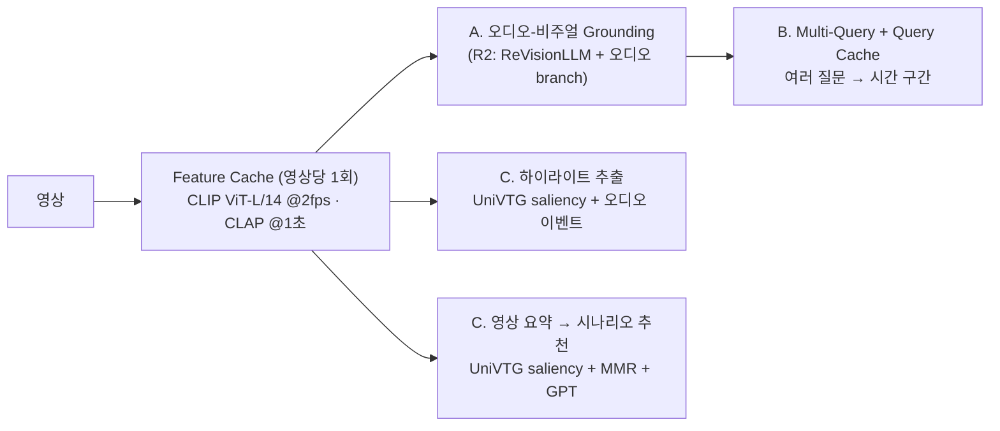
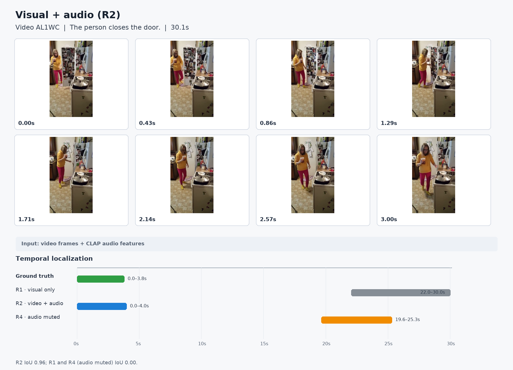
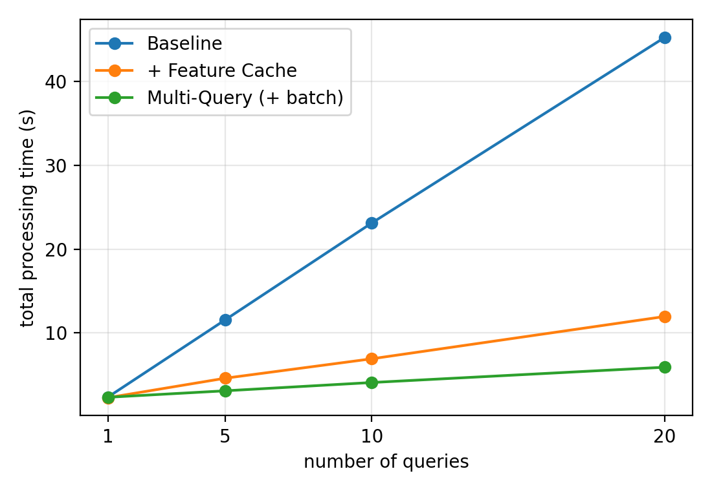
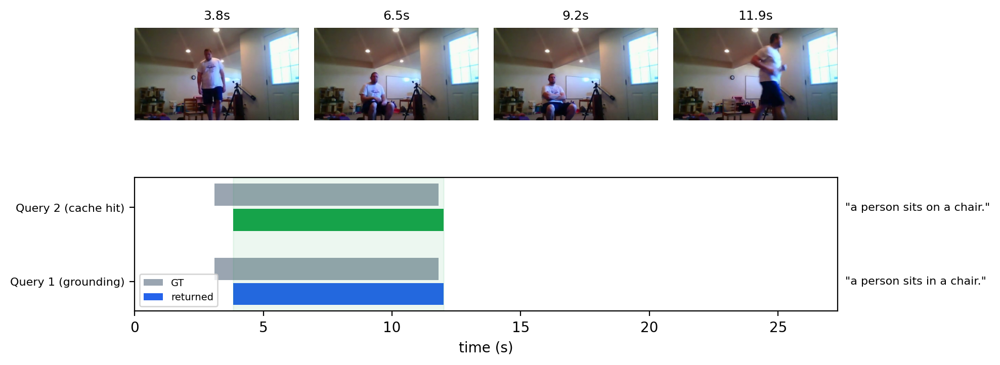
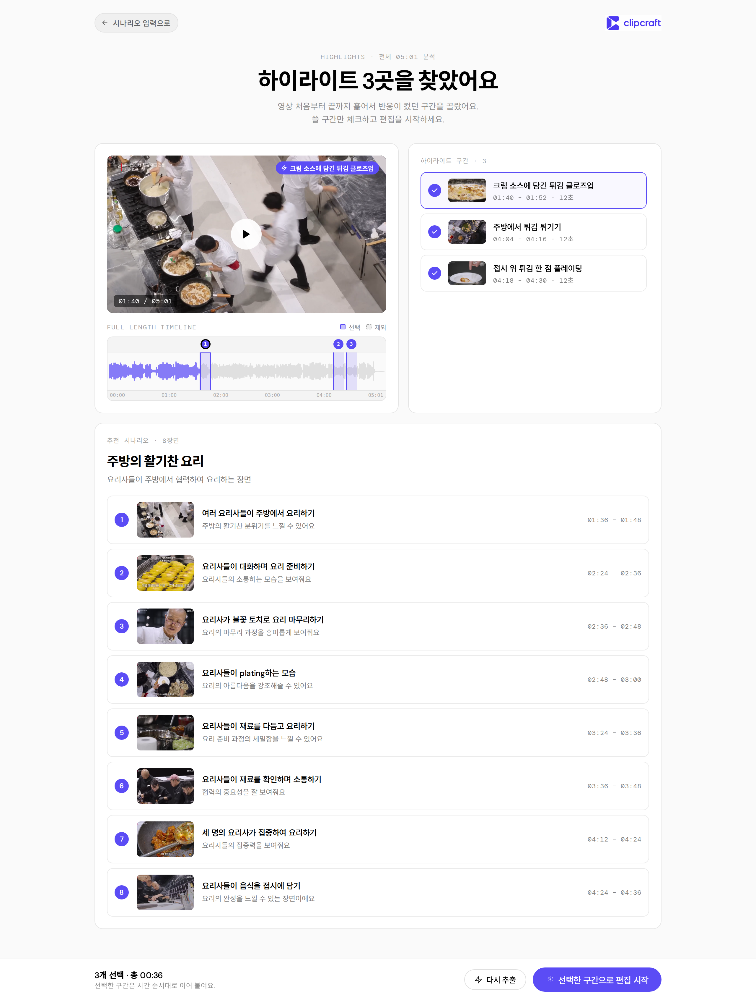

# ClipCraft-AI

**영상 검색·편집을 위한 AI 모듈 모음.** 공개 [ReVisionLLM](https://arxiv.org/pdf/2411.14901)(영상에서 문장이 일어나는 시간 구간을 찾는 LLM)을 기반으로,
소리를 이해하고(오디오 branch), 여러 질문을 빠르게 처리하고(캐시), 영상에서 하이라이트와 편집 시나리오를 뽑는(UniVTG) 기능을 더했다.

| | 기능 | 한 줄 설명 |
| --- | --- | --- |
| A | **오디오-비주얼 Grounding** | 영상 프레임에 CLAP 오디오 feature를 더해 "웃는다", "문을 닫는다" 같은 소리 단서가 있는 문장의 구간을 더 잘 찾는다 |
| B | **Multi-Query + Feature / Semantic Query Cache** | 영상 feature는 한 번만 뽑아 공유하고, 한 영상에 여러 질문을 묶어 처리하고, 비슷한 질문은 이전 결과를 재사용한다 |
| C | **하이라이트 추출 + 영상 요약 → 시나리오 추천** | UniVTG로 영상의 중요도를 초 단위로 계산해 하이라이트 영상을 만들고, 대표 장면 8곳으로 편집 시나리오를 추천한다 |

세 기능은 **한 번 추출해 캐시한 CLIP(영상) + CLAP(오디오) feature를 함께 쓴다.** 영상 인코딩은 파일당 한 번이다.



---

## 1. 한눈에 보는 결과

| 기능 | 핵심 결과 | 주의 |
| --- | --- | --- |
| A. 오디오 branch | Charades-STA test(3,720 query)에서 오디오를 쓴 모델 R2 mIoU **53.26** vs 오디오 없는 기준 R1 **52.50 ± 0.15**(시드 2개). 같은 모델에서 오디오만 끄면 R1@0.5가 **1.51p 하락**(95 % CI [+0.38, +2.64]) | R2 − R1 전체 차이는 시드 한 개에서만 유의한 **경계 수준**. R2는 시드 1개 |
| B. Multi-Query + 캐시 | 쿼리당 지연 **2.54초 → 1.29초(Feature Cache) → 1.22초(+ Semantic Cache)**, 20쿼리 처리시간 Baseline 45.3초 → Multi-Query 5.9초(약 7.7배) | 정확도 차이(mIoU 0.4p 이내)는 샘플링 노이즈로 해석했고 반복 측정으로 확인하지는 않음 |
| C. 하이라이트 점수 | TVSum 35개 영상 mAP@5 **0.580** (CLIP 제로샷 L/14 0.526, B/32 0.462, 무작위 0.427), F1@15 % 0.258 | L/14 제로샷 대비 mAP 차이는 통계적으로 유의하지 않고(F1@15 %만 유의), 최종 하이라이트·요약·시나리오 품질의 정답 기반 평가는 없음 |

자세한 수치·통계·한계는 각 문서에 있다: [METHOD.md](METHOD.md), [RESULTS.md](RESULTS.md), [docs/MULTIQUERY.md](docs/MULTIQUERY.md), [revisionllm/editing/README.md](revisionllm/editing/README.md).

---

## 2. A. 오디오-비주얼 Grounding

ReVisionLLM이 보는 CLIP 프레임 feature에 오디오 항을 **어댑터에 들어가기 전에 더한다.** 텐서 모양이 바뀌지 않아 LLM 쪽은 그대로이다.

```
ṽ_t = v_t + α · LayerNorm( W₂ · GELU( W₁ · a_t ) )     v_t: CLIP 프레임(768), a_t: 그 시각의 CLAP 1초 벡터(512)
```

- 오디오 인코더 CLAP(`laion/clap-htsat-fused`), CLIP, Vicuna-7B는 동결하고 **오디오 branch(약 98.6만 파라미터) + 어댑터 + LoRA**만 학습한다.
- 초기에는 오디오 항이 0이라 공개 체크포인트와 같은 출력에서 학습을 시작한다. modality dropout(영상 15 %, 오디오 15 %)을 쓴다.
- 비교: **R1**(오디오 없음, 같은 데이터·step), **R2**(오디오 포함), **R4**(R2에서 추론 때만 오디오 0).



위는 "The person closes the door."에서 R2(오디오 포함)만 정답 구간을 찾은 **한 사례**이다(R2 IoU 0.96, R1·R4 IoU 0).
전체 통계로는 R2가 R1보다 좋아지는 방향이 일관되지만, R1 두 시드끼리도 query 약 260개의 정답 여부가 서로 뒤집혀서
**개별 사례만으로는 오디오 효과의 근거가 되지 않는다.** 전체 수치와 R4 대조, 오디오가 오히려 해친 사례는 [RESULTS.md](RESULTS.md).

| 모델 | mIoU | R1@0.3 | R1@0.5 | R1@0.7 |
| --- | --- | --- | --- | --- |
| R0 (미세조정 전 공개 체크포인트) | 16.90 | 26.13 | 14.27 | 5.13 |
| R1 (오디오 없음, 시드 2개 평균) | 52.50 | 73.82 | 61.34 | 38.58 |
| **R2 (오디오 포함)** | **53.26** | **75.00** | **62.63** | **39.35** |
| R4 (R2에서 오디오 제거) | 52.17 | 73.25 | 61.13 | 38.58 |

Charades-STA test 3,720 query. 효과는 소리가 나는 동작이 들어간 query(2,099개)에 집중되고(R1@0.5 +2.2~2.3p, 두 시드 모두 유의), 그 외 query에서는 관찰되지 않았다.

---

## 3. B. Multi-Query + Feature / Semantic Query Cache

```
Video ─ SHA-256 ─ video 테이블 조회
          ├ 히트: vision.npy / audio.npy 로드
          └ 미스: CLIP + CLAP 추출 → 저장                      (영상당 1회)
각 Query ─ CLIP 텍스트 임베딩 ─ 같은 영상의 query_cache를 pgvector 코사인으로 검색
          ├ 유사도 > 0.95: 저장된 구간 반환
          └ 그 외: Grounding(여러 쿼리를 한 배치로) → 구간 반환 + 저장
```



| 구성 | mIoU | R1@0.5 | 쿼리당 지연(초) | feature 추출 | grounding 호출 |
| --- | --- | --- | --- | --- | --- |
| Baseline | 52.72 | 61.92 | 2.54 | 822 | 822 |
| + Feature Cache | 53.08 | 62.65 | 1.29 | 300 | 822 |
| + Semantic Cache | 53.12 | 62.17 | 1.22 | 300 | 786 (36개 히트) |

Charades-STA 영상 300개 / 쿼리 822개, RTX 3090 1장. 유사 쿼리 재사용은 threshold 0.95에서 히트의 98.0 %가 같은 장면을 가리켰다(전체 쌍의 3.6 %가 히트).
지연은 각 구성을 한 번씩 측정한 값이고 GPU를 다른 프로세스와 공유했다.



"a person sits in a chair."로 grounding한 뒤, 유사한 "a person sits on a chair."(유사도 0.983)는 grounding 없이 같은 구간을 반환한다
(동작을 보여 주기 위해 고른 예시이며 대표 사례가 아니다). 자세한 내용: [docs/MULTIQUERY.md](docs/MULTIQUERY.md).

---

## 4. C. 하이라이트 추출 + 영상 요약 → 시나리오 추천

캐시된 CLIP ViT-L/14 feature를 **Linear Adapter(768→512)** 로 UniVTG(CLIP-B/32용 공개 모델, 동결)의 feature 공간에 맞춰 영상 제목과의 유사도(saliency)를 초 단위로 구한다.
학습한 것은 Adapter 한 층뿐이다(Charades 검증 cosine 0.923).

| 하이라이트 | 영상 요약 → 시나리오 |
| --- | --- |
|  |  |

- **하이라이트**: `0.7 × UniVTG saliency + 0.3 × 오디오 이벤트(CLAP: 웃음·박수·음악·말 등)` 점수가 높은 지점에서 클립을 키워 영상 길이의 약 10 %(15~60초)를 이어 붙인다.
- **요약 → 시나리오**: 영상을 고정 길이 윈도우(영상 6분 미만 12초 · 20분 미만 20초 · 그 이상 30초)로 자르고, 중요도와 다양성(MMR)으로 8곳을 골라
  키프레임을 GPT(gpt-4o-mini)에 보내 캡션을 만든 뒤, 시간순으로 정리된 시나리오(제목·요약·장면별 설명·추천 이유)를 받는다.



위는 요리 영상 한 편(약 5분)의 결과 화면이다. 하이라이트 3곳(36초)과 8개 장면 시나리오가 표시된다. 4개 영상 전체 결과는 `results/highlights/`.

**검증 요약 (정확히 무엇을 확인했는가)**
- UniVTG 구현이 원본과 같은 가중치에서 출력이 비트 단위로 일치한다. Adapter는 Charades 검증 cosine 0.923(선형 변환의 이론 상한 0.924).
- TVSum 35개 영상 하이라이트 mAP@5 0.580. 진짜 B/32 입력 대비 Adapter의 차이는 유의하지 않았다(mAP@5 −0.016, 95 % CI [−0.071, +0.036]; 신뢰구간이 넓어 작은 손실을 배제하지는 못함).
- 하이라이트·요약·시나리오의 **최종 품질을 정답과 비교한 정량 평가는 없다.** 실제 영상 4개(100~300초)에서 눈으로 확인했고, GPT 캡션이 화면에 없는 내용을 지어내는 경우가 있었다.
- 가중치 0.7/0.3, 윈도우 길이 표, 10 % 예산 등은 정해 둔 값이며 최적화·비교 검증하지 않았다.

---

## 5. 저장소 구조

```
revisionllm/
  model/adapter/audio_fusion.py   오디오 branch (A)
  train/, eval/                   학습·평가 코드 (ReVisionLLM 기반)
  multiquery/                     Multi-Query + Feature / Semantic Query Cache (B)
  editing/                        하이라이트 · 요약 · 시나리오 추천, UniVTG 스코어러 (C)
scripts/audio/                    오디오 실험 실행 스크립트 (환경 구축 ~ 평가)
scripts/highlights/               하이라이트 / 시나리오 추천 실행, 결과 화면 도구
scripts/univtg/                   UniVTG Adapter 학습
docs/                             MULTIQUERY.md, 도면(docs/diagrams), 그림(docs/figures)
METHOD.md · RESULTS.md · PLAN.md  방법 · 결과 · 계획 (오디오 실험)
results/                          multiquery 평가, 하이라이트 결과
tests/                            test_audio_fusion / test_multiquery_cache / test_editing / test_univtg_scorer
```

## 6. 설치와 실행

**환경** (오디오·캐시·편집 모듈): Python 3.10, PyTorch 2.4.1(cu121). 환경 구축부터 학습·평가 순서는 [scripts/audio/README.md](scripts/audio/README.md).

```bash
conda create -n revaudio python=3.10 -y && conda activate revaudio
pip install torch==2.4.1 torchvision==0.19.1 torchaudio==2.4.1 --index-url https://download.pytorch.org/whl/cu121
pip install -r requirements.txt
```

**체크포인트와 외부 자원**: CLIP, Vicuna-v1.5, Stage-1/2 가중치는 [VTimeLLM](https://github.com/huangb23/VTimeLLM/blob/main/docs/train.md)을 따라 `checkpoints/`에 둔다.
학습한 R2 체크포인트는 `checkpoints/audio_charades_long/`, UniVTG와 Adapter는 `checkpoints/univtg/`에 둔다(저장소에 포함되어 있지 않다).
Multi-Query 캐시와 편집 결과 캐시는 PostgreSQL + pgvector가 필요하다(`CLIPCRAFT_DB_DSN`).

**A. 학습·평가 (오디오 branch)**
```bash
bash scripts/audio/charades.sh run
```

**B. 여러 질문으로 grounding**
```bash
export CLIPCRAFT_DB_DSN=postgresql://localhost:5432/clipcraft
python revisionllm/multiquery/cli.py --video X.mp4 --query "the person closes the door." --query "a person is sneezing"
```

**C. 하이라이트 / 시나리오 추천**
```bash
export OPENAI_API_KEY=...  CLIPCRAFT_DB_DSN=postgresql://localhost:5432/clipcraft
python revisionllm/editing/cli.py recommend --video X.mp4 --goal "1분 요약" --title "영상 제목"
python revisionllm/editing/cli.py highlight --video X.mp4 --out X_highlight.mp4 --title "영상 제목"
```

**테스트**
```bash
python -m pytest tests/test_editing.py tests/test_univtg_scorer.py tests/test_audio_fusion.py
CLIPCRAFT_TEST_DSN=postgresql://localhost:5433/clipcraft python -m pytest tests/test_multiquery_cache.py   # DB 필요
```

## 7. 한계와 주의

- **오디오 효과는 경계 수준이다.** R2는 시드 1개이고, R2 − R1 차이는 한 시드에서만 유의하다. 오디오를 끈 대조(R2 − R4)는 유의하다. 평가는 Charades-STA(약 30초 영상) 한 곳이며 긴 영상·다른 데이터셋의 일반화는 확인하지 않았다.
- **캐시의 정확도 유지는 가정이다.** 구성 간 정확도 차이를 샘플링 노이즈로 해석했을 뿐, 같은 구성을 반복해 편차를 재지 않았다. 계층 검색(긴 영상) 단계는 연결하지 않았다.
- **하이라이트·요약·시나리오는 정답 기반 평가가 없다.** GPT 캡션 환각이 있고, 영상 약 11분까지만 UniVTG 입력 경로를 검증했다.
- **라이선스**: 아래 라이선스(CC BY-NC-ND 4.0)와 Charades·VidChapters-7M의 비상업 연구용 조건 때문에, 이 결과와 가중치를 상업 목적에 그대로 쓸 수 없다.

---

<details>
<summary><b>원본 ReVisionLLM (MAD / VidChapters-7M 학습·평가)</b></summary>

ReVisionLLM은 영상 안에서 넓은 구간부터 시작해 점점 범위를 좁히며 시간 경계를 찾는 recursive vision-language model로, 시간~수 시간 길이 영상의 temporal grounding을 다룬다(CVPR 2025).
저자 공개 가중치: [Google Drive](https://drive.google.com/drive/folders/19wqQ5QWijClP8XaWd031eAK6hGQA_7mX?usp=share_link).


원본 환경(PyTorch 1.13.1, CUDA 11.6):
```shell
conda create --name=revisionllm python=3.10 && conda activate revisionllm
conda install pytorch==1.13.1 torchvision==0.14.1 torchaudio==0.13.1 pytorch-cuda=11.6 -c pytorch -c nvidia
pip install -r requirements.txt
pip install ninja && pip install flash-attn==2.5.6 --no-build-isolation
```

**MAD 데이터**: [RGNet](https://github.com/Tanveer81/RGNet)을 따라 feature를 `/data/mad/`에 두고
```shell
python revisionllm/data/mad/mad_to_activitynet.py
python revisionllm/data/feature_extraction/mad_clip_text_extractor.py
```
**VidChapters-7M 데이터**: [VidChapters-7M](https://github.com/antoyang/VidChapters)을 `/data/chapters/`에 받고
```shell
python revisionllm/data/feature_extraction/chapters_clip_text_extractor.py
python revisionllm/data/vidchap7m/chapters_clip_extractor.py
python revisionllm/data/vidchap7m/chapters_test_to_activitynet.py
python revisionllm/data/vidchap7m/chapters_to_activitynet.py
```
**학습 / 추론**
```shell
sh scripts/mad/stage1_dense.sh && sh scripts/mad/stage1_sparse.sh && sh scripts/mad/stage2_long_33.sh && sh scripts/mad/stage2_long_100.sh
bash scripts/mad/eval_stage1_dense.sh && bash scripts/mad/eval_stage2_33.sh && bash scripts/mad/eval_stage2_100.sh
python revisionllm/eval/metric_retrieval_forward.py

sh scripts/chapters/stage1_dense.sh && sh scripts/chapters/stage1_sparse.sh && sh scripts/chapters/stage2_long_100.sh
bash scripts/chapters/eval_stage1_dense.sh && bash scripts/chapters/eval_stage2_100.sh
python revisionllm/eval/metric_retrieval_forward_chapters.py
```


</details>

---

## Acknowledgements

이 프로젝트는 아래 오픈소스 위에 만들어졌다.

* [ReVisionLLM](https://github.com/Tanveer81/ReVisionLLM): 기반 모델 (Hannan et al., CVPR 2025)
* [VTimeLLM](https://github.com/huangb23/VTimeLLM), [LLaVA](https://github.com/haotian-liu/LLaVA), [FastChat](https://github.com/lm-sys/FastChat), [Video-ChatGPT](https://github.com/mbzuai-oryx/Video-ChatGPT), [LLaMA](https://github.com/facebookresearch/llama)
* [UniVTG](https://github.com/showlab/UniVTG): 하이라이트·요약의 중요도 점수 (MIT)
* [CLAP](https://github.com/LAION-AI/CLAP): 오디오 feature, [CLIP](https://github.com/openai/CLIP): 영상·텍스트 feature
* 데이터: [Charades-STA](https://github.com/jiyanggao/TALL), [VidChapters-7M](https://github.com/antoyang/VidChapters), [MAD](https://github.com/Soldelli/MAD), [TVSum](https://github.com/yalesong/tvsum)

기반 모델을 사용한다면 아래를 인용해 주세요.
```bibtex
@article{hannan2024revisionllm,
  title={ReVisionLLM: Recursive Vision-Language Model for Temporal Grounding in Hour-Long Videos},
  author={Hannan, Tanveer and Islam, Md Mohaiminul and Gu, Jindong and Seidl, Thomas and Bertasius, Gedas},
  journal={arXiv preprint arXiv:2411.14901},
  year={2024}
}
```

## License
<a rel="license" href="https://creativecommons.org/licenses/by-nc-nd/4.0/"></a>

This work is licensed under a <a rel="license" href="http://creativecommons.org/licenses/by-nc-nd/4.0/">Creative Commons Attribution-NonCommercial-NoDerivs 4.0 International License</a>.
