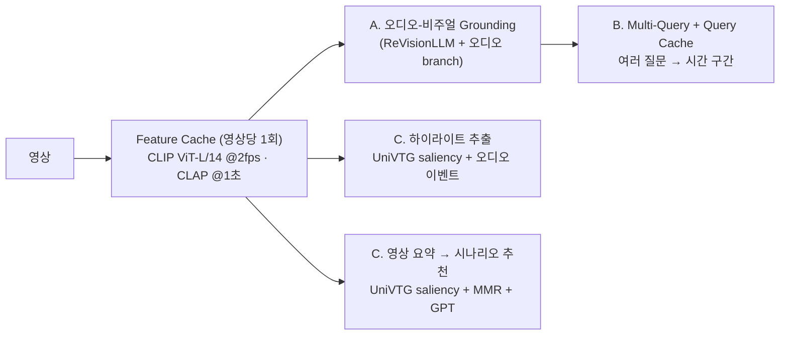
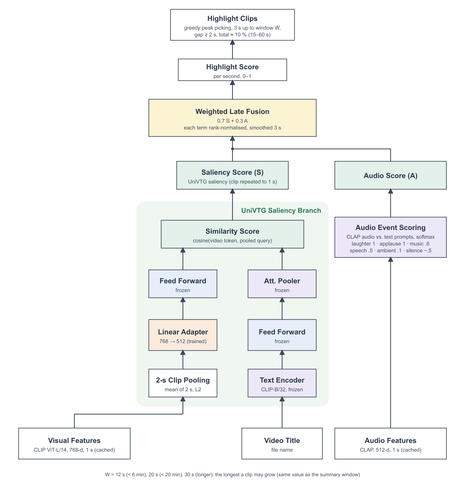
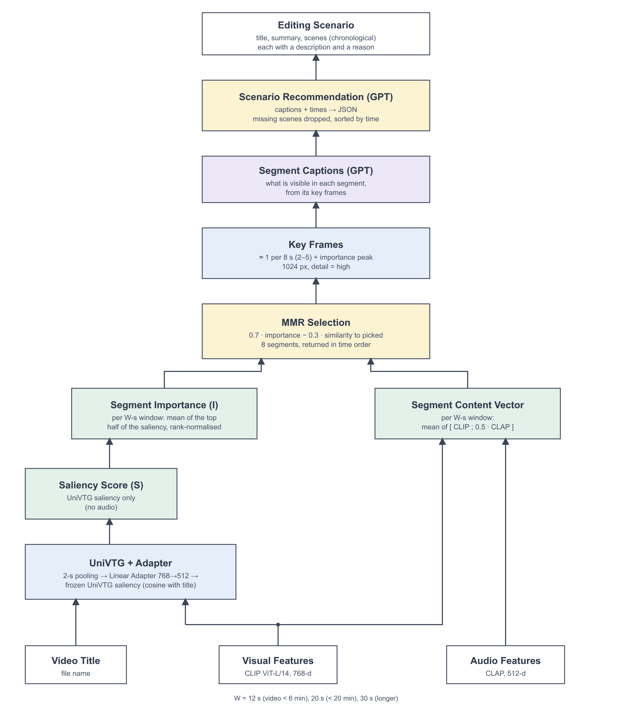

# ClipCraft-AI

**영상 검색·편집을 위한 AI 추론 모듈.** 공개 [ReVisionLLM](https://arxiv.org/pdf/2411.14901)(영상에서 문장이 일어나는 시간 구간을 찾는 LLM)을 기반으로 하고, 하이라이트·영상 요약의 중요도 점수에는 [UniVTG](https://github.com/showlab/UniVTG)(영상 하이라이트·구간 검색 모델)를 사용한다. UniVTG는 저장소를 포크하지 않고, 추론에 필요한 모델 코드(`revisionllm/editing/univtg/`, MIT 라이선스 파일 포함)와 공개 가중치만 가져와 쓴다.

이 브랜치(`main`)에는 **추론 코드만** 있다. 학습 스크립트, 실험·평가 코드, 학습된 체크포인트와 로그, 결과물은 `audio-fusion` 브랜치에 있다.

| | 기능 | 한 줄 설명 | 코드 |
| --- | --- | --- | --- |
| A | **오디오-비주얼 Grounding** | 영상 프레임에 CLAP 오디오 feature를 더해, 소리 단서가 있는 문장("웃는다", "문을 닫는다")의 시간 구간을 찾는다 | `revisionllm/model/`, `revisionllm/inference.py` |
| B | **Multi-Query + Feature / Semantic Query Cache** | 영상 feature는 한 번만 추출해 공유하고, 한 영상의 여러 질문을 한 배치로 처리하고, 비슷한 질문은 이전 결과를 재사용한다 | `revisionllm/multiquery/` |
| C | **하이라이트 추출 + 영상 요약 → 시나리오 추천** | UniVTG로 영상 중요도를 초 단위로 계산해 하이라이트 영상을 만들고, 대표 장면 8곳으로 편집 시나리오를 추천한다 | `revisionllm/editing/` |

세 기능은 **한 번 추출해 캐시한 CLIP(영상) + CLAP(오디오) feature를 함께 쓴다.** 영상 인코딩은 파일당 한 번이다.



---

## A. 오디오-비주얼 Grounding

ReVisionLLM이 보는 CLIP 프레임 feature에 오디오 항을 **어댑터에 들어가기 전에 더한다.** 텐서 모양이 바뀌지 않아 LLM 쪽은 그대로이다.

```
ṽ_t = v_t + α · LayerNorm( W₂ · GELU( W₁ · a_t ) )     v_t: CLIP 프레임(768), a_t: 그 시각의 CLAP 1초 벡터(512)
```

- 오디오 인코더 CLAP(`laion/clap-htsat-fused`)은 1초 창·1초 hop으로 feature를 뽑는다. 코드는 `revisionllm/model/adapter/audio_fusion.py`.
- 오디오 branch는 학습된 체크포인트가 필요하다(이 브랜치에는 포함되어 있지 않다).


## B. Multi-Query + Feature / Semantic Query Cache

```
Video ─ SHA-256 ─ video 테이블 조회
          ├ 히트: vision.npy / audio.npy 로드
          └ 미스: CLIP + CLAP 추출 → 저장                      (영상당 1회)
각 Query ─ CLIP 텍스트 임베딩 ─ 같은 영상의 query_cache를 pgvector 코사인으로 검색
          ├ 유사도 > 0.95: 저장된 구간 반환
          └ 그 외: Grounding(여러 쿼리를 한 배치로) → 구간 반환 + 저장
```

- `feature_version` 또는 `model_version`이 바뀌면 feature와 결과 캐시를 다시 계산한다. 다른 체크포인트의 결과는 재사용하지 않는다.
- PostgreSQL + pgvector가 필요하다. 자세한 설계: [revisionllm/multiquery/README.md](revisionllm/multiquery/README.md).

## C. 하이라이트 추출 + 영상 요약 → 시나리오 추천

캐시된 CLIP ViT-L/14 feature를 **Linear Adapter(768→512)** 로 UniVTG(CLIP-B/32용 공개 모델, 동결)의 feature 공간에 맞춰 영상 제목과의 유사도(saliency)를 초 단위로 구한다.

| 하이라이트 | 영상 요약 → 시나리오 |
| --- | --- |
|  |  |

- **하이라이트**: `0.7 × UniVTG saliency + 0.3 × 오디오 이벤트(CLAP: 웃음·박수·음악·말 등)` 점수가 높은 지점에서 클립을 키워 영상 길이의 약 10 %(15~60초)를 이어 붙인다.
- **요약 → 시나리오**: 영상을 고정 길이 윈도우(영상 6분 미만 12초 · 20분 미만 20초 · 그 이상 30초)로 자르고, 중요도와 다양성(MMR)으로 8곳을 골라
  키프레임을 GPT(gpt-4o-mini)에 보내 캡션을 만든 뒤, 시간순으로 정리된 시나리오(제목·요약·장면별 설명·추천 이유)를 받는다.
- 점수 계산, 파일 구성, 검증 범위와 한계: [revisionllm/editing/README.md](revisionllm/editing/README.md).

---

## 저장소 구조

```
revisionllm/
  model/            모델 (ReVisionLLM + 오디오 branch)
  inference.py      grounding 추론
  multiquery/       B. Multi-Query + Feature / Semantic Query Cache
  editing/          C. 하이라이트 · 요약 · 시나리오 추천, UniVTG 스코어러
  data/             feature 추출기 (CLIP, CLAP)
scripts/highlight/  하이라이트 실행 (run_highlight.py)
scripts/summary/    영상 요약 실행, LLM 없음 (run_summary.py)
scripts/scenario/   시나리오 추천 실행, GPT 사용 (run_scenario.py)
docs/diagrams/      파이프라인 도면 (svg, png, draw.io)
tests/              test_multiquery_cache / test_editing / test_univtg_scorer
```

## 설치

Python 3.10, PyTorch 2.4.1(cu121).

```bash
conda create -n revaudio python=3.10 -y && conda activate revaudio
pip install torch==2.4.1 torchvision==0.19.1 torchaudio==2.4.1 --index-url https://download.pytorch.org/whl/cu121
pip install -r requirements.txt
```

## 필요한 외부 자원 (저장소에 포함되어 있지 않음)

| 자원 | 위치 | 용도 |
| --- | --- | --- |
| CLIP ViT-L/14, Vicuna-7B v1.5, Stage-1/2 가중치 | `checkpoints/` ([VTimeLLM](https://github.com/huangb23/VTimeLLM/blob/main/docs/train.md) 안내) | A, B |
| 오디오 branch를 학습한 체크포인트 | `checkpoints/audio_charades_long/stageB_R2_seed0` | A, B |
| UniVTG(`univtg_ft_b32.pt`)와 Adapter(`adapter_align.pt`) | `checkpoints/univtg/` | C |
| PostgreSQL + pgvector | `CLIPCRAFT_DB_DSN` | B, C |
| OpenAI API 키 | `OPENAI_API_KEY` | C (캡션·시나리오) |

## 실행

**B. 여러 질문으로 grounding**
```bash
export CLIPCRAFT_DB_DSN=postgresql://localhost:5432/clipcraft
python revisionllm/multiquery/cli.py --video X.mp4 --query "the person closes the door." --query "a person is sneezing"
```

**C. 하이라이트 / 시나리오 추천**
```bash
export OPENAI_API_KEY=...  CLIPCRAFT_DB_DSN=postgresql://localhost:5432/clipcraft
python revisionllm/editing/cli.py summary   --video X.mp4 --title "영상 제목"                    # 대표 구간 (LLM 없음)
python revisionllm/editing/cli.py scenario  --video X.mp4 --goal "1분 요약" --title "영상 제목"   # 요약 → 캡션 → 시나리오 (GPT)
python revisionllm/editing/cli.py highlight --video X.mp4 --out X_highlight.mp4 --title "영상 제목"
```

루트의 영상 전체에 한꺼번에 돌릴 때: `python scripts/highlight/run_highlight.py`, `python scripts/summary/run_summary.py`, `python scripts/scenario/run_scenario.py` (결과는 `results/highlight|summary|scenario/`에 쓴다). 시나리오는 요약 결과를 이어받아 쓰며, 요약이 캐시에 없으면 먼저 계산한다.

**테스트**
```bash
python -m pytest tests
CLIPCRAFT_TEST_DSN=postgresql://localhost:5433/clipcraft python -m pytest tests/test_multiquery_cache.py   # DB 필요
```

---

## Acknowledgements

* [ReVisionLLM](https://github.com/Tanveer81/ReVisionLLM): 기반 모델 (Hannan et al., CVPR 2025)
* [VTimeLLM](https://github.com/huangb23/VTimeLLM), [LLaVA](https://github.com/haotian-liu/LLaVA), [FastChat](https://github.com/lm-sys/FastChat), [Video-ChatGPT](https://github.com/mbzuai-oryx/Video-ChatGPT), [LLaMA](https://github.com/facebookresearch/llama)
* [UniVTG](https://github.com/showlab/UniVTG): 하이라이트·요약의 중요도 점수 (MIT)
* [CLAP](https://github.com/LAION-AI/CLAP): 오디오 feature, [CLIP](https://github.com/openai/CLIP): 영상·텍스트 feature

기반 모델을 사용한다면 아래를 인용해 주세요.
```bibtex
@article{hannan2024revisionllm,
  title={ReVisionLLM: Recursive Vision-Language Model for Temporal Grounding in Hour-Long Videos},
  author={Hannan, Tanveer and Islam, Md Mohaiminul and Gu, Jindong and Seidl, Thomas and Bertasius, Gedas},
  journal={arXiv preprint arXiv:2411.14901},
  year={2024}
}
```

## License
<a rel="license" href="https://creativecommons.org/licenses/by-nc-nd/4.0/"></a>

This work is licensed under a <a rel="license" href="http://creativecommons.org/licenses/by-nc-nd/4.0/">Creative Commons Attribution-NonCommercial-NoDerivs 4.0 International License</a>.
