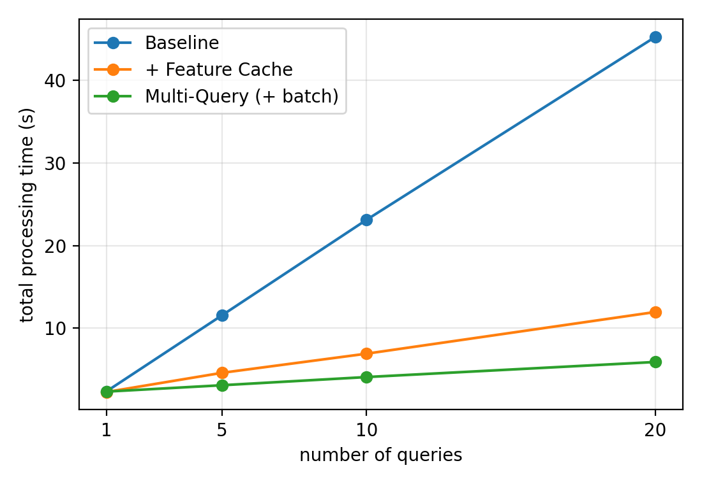
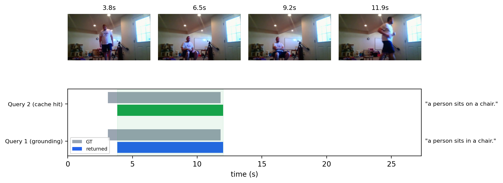

# Multi-Query Grounding + Feature / Semantic Query Cache

R2 체크포인트(`checkpoints/audio_charades_long/stageB_R2_seed0`, 오디오-비주얼 ReVisionLLM)에 **다중 쿼리 처리**,
**Shared Feature Cache**, **Semantic Query Cache**를 추가했다. 코드는 `revisionllm/multiquery/`에 있고,
사용법은 [README](../revisionllm/multiquery/README.md)에 있다.

---

## 1. 구현

### 1.1 처리 흐름

```
Video ─ SHA-256 ─ video 테이블 조회
          ├ 히트: vision.npy / audio.npy 로드
          └ 미스: CLIP(2fps) + CLAP(1s) 추출 → 파일 저장 → DB 등록   (영상당 1회)
                         ↓
              윈도우 구성 (쿼리와 무관, 1회) ── 모든 쿼리가 공유
                         ↓
각 Query ─ CLIP 텍스트 인코딩 ─ EOT 임베딩으로 같은 video_id의 query_cache 검색 (pgvector 코사인)
          ├ 유사도 > threshold: 저장된 (start, end) 반환
          └ 그 외: Grounding → (start, end) 반환 + query_cache에 저장
```

### 1.2 구성 요소

| 파일 | 역할 |
| --- | --- |
| `feature_cache.py` | SHA-256 해시, `ClipFrameExtractor` / `ClapAudioExtractor`로 feature 추출, 파일 저장, 버전 검사 |
| `db.py` | PostgreSQL + pgvector 스키마와 질의 (`video` 1 → N `query_cache`) |
| `grounder.py` | R2 모델 1회 로드, 영상 윈도우 1회 구성, 쿼리별 grounding (기존 dense 경로) |
| `service.py` | 위 흐름을 묶는 `MultiQueryGrounder` |
| `cli.py` / `evaluate.py` / `calibrate.py` | 실행 / 평가 / threshold 검증 |

### 1.3 기존 코드 재사용

모델 구조와 기존 오디오 branch는 가정 없이 실제 코드를 읽고 그대로 썼다. 새로 만든 것은 캐시 계층이고, grounding 자체는
`eval_nlq_negative.py`의 dense 경로(R2 평가에 쓰인 것)와 같다.

- 재사용: `ClipFrameExtractor`, `ClapAudioExtractor`, `ClipFeatureExtractor.encode_text`, `AudioStore.align`,
  `inference`, `eval_nlq_negative`의 `iou` / `questions` / `parse_args`, `_topk_pooling`
- 윈도우 구성(500초 이하 영상은 250프레임으로 늘려 윈도우 1개), 프롬프트, `iteration_step=1`, cosine top-k 후보 점수화는
  `eval_nlq_negative.eval`과 동일하다.
- 쿼리 임베딩은 모델이 이미 쓰는 CLIP 텍스트 EOT feature(768차원)를 재사용했다. 별도 임베딩 모델은 없다.

### 1.4 DB 스키마 (Fig. 6)

| 테이블 | 컬럼 |
| --- | --- |
| `video` | `video_id` PK, `video_hash` UNIQUE, `vision_feature`(경로), `audio_feature`(경로), **`duration`**, **`feature_version`** |
| `query_cache` | `query_id` PK, `video_id` FK, `query_text`, `query_embedding` VECTOR(768), `start_time`, `end_time`, **`model_version`** |

굵게 표시한 컬럼은 명세에 없던 것을 추가했다. Feature Tensor는 파일로 저장하고 DB에는 경로만 둔다.

### 1.5 버전 관리

- `feature_version`(extractor 이름, fps, hop, schema 번호)이 다르면 feature를 다시 추출하고 그 영상의 쿼리 캐시를 지운다.
- `model_version`(체크포인트 디렉터리 + adapter 크기/수정시각)은 검색 조건에 포함된다. 다른 체크포인트의 결과는 재사용되지 않는다.

### 1.6 Multi-Query 배치 (모델 코드 수정 포함)

쿼리마다 프롬프트 길이가 달라, 기존 `generate` 경로로는 한 배치로 묶을 수 없었다. 그 경로가 첫 step 이후 attention mask를
전부 1로 다시 만들어 패딩이 어텐션에 들어갔기 때문이다. 다음을 수정했다.

| 파일 | 수정 |
| --- | --- |
| `vtimellm_llama.py` | 첫 step의 프롬프트 mask를 `_gen_attention_mask`에 보관하고, 이후 step에서 그 mask를 이어 씀 (패딩이 없으면 기존과 동일) |
| `inference.py` | 프롬프트 리스트를 받으면 left padding + `attention_mask`를 `generate`에 전달 (단일 프롬프트 호출은 그대로) |
| `grounder.py` | `tokenizer_padding_side = "left"` 설정, 행 = (쿼리, 윈도우), 프롬프트 길이순 정렬, `--query_batch`(기본 8)로 GPU 메모리 제한 |

한 요청 안에서 서로 유사한 미스 쿼리는 앞 쿼리의 결과를 따라가서 grounding을 한 번만 한다.

### 1.7 평가 구성 (`evaluate.py`)

| 구성 | 동작 |
| --- | --- |
| Baseline | 쿼리마다 독립 요청: feature 재추출, 캐시 없음 |
| + Feature Cache | feature는 영상당 1회 추출, 쿼리는 하나씩 grounding |
| + Semantic Cache | + Feature Cache, 유사 쿼리는 저장된 구간 재사용 |
| Multi-Query (그래프용) | + Feature Cache, 한 영상의 모든 쿼리를 공유 forward 패스로 배치 |

---

## 2. 확인된 동작 (기능 검증)

환경: CPU fp32, 영상 `AL1WC`(30초) 등 로컬 영상 3개. GPU 검증은 하지 못했다.

| 항목 | 결과 |
| --- | --- |
| 저장된 CLIP feature와 새로 추출한 feature | cosine 0.999996 (사실상 동일) |
| 같은 영상 재입력 | Feature 추출 생략 (`features=cache hit`) |
| 유사 쿼리 재입력 | Grounding 생략, 저장된 구간 반환 (예: "person closes the door" ↔ "the person closes the door." 유사도 0.964) |
| 영상 간 격리 | 다른 영상의 쿼리 캐시는 검색되지 않음 (테스트) |
| 버전 변경 | feature_version / model_version 변경 시 재추출·재계산 (테스트) |
| 기존 평가와 비교 | 같은 CPU에서 `eval_nlq_negative.py`는 "From 00 to 37", 구현은 "00 to 39" (GT 0~3.8초) |
| 패딩 배치 | 패딩된 행의 처음 6 step logit이 단독 실행과 완전 일치 (차이 0.0). mask 수정을 끈 대조군은 6~12 차이 |
| 테스트 | `tests/test_multiquery_cache.py` 4개 + 기존 테스트 통과 (총 9개) |

### Semantic Cache threshold 검증 (`calibrate.py`)

Charades-STA 테스트의 같은 영상 쿼리 쌍 5,527개에서, 캐시 히트가 실제로 같은 장면(GT IoU ≥ 0.5)을 가리키는 비율이다.

| threshold | 전체 쌍 중 히트 | 히트의 정확도 |
| --- | --- | --- |
| 0.90 | 11.4% | 90.7% |
| **0.95 (기본값)** | **3.6%** | **98.0%** |
| 0.97 | 1.3% | 97.2% |

### 알려진 이슈

- CLAP 추출(transformers의 fused 전처리)이 실행마다 일부 윈도우에서 달라진다. 이 차이만으로 grounding이 크게 바뀐 사례가 있었다.
  재현성을 위해 추출 직전에 `np.random.seed(0)`을 설정했고, 같은 영상 두 번 추출이 완전히 일치함을 확인했다.
  기존 LMDB의 오디오 feature에는 같은 변동이 섞여 있을 수 있다.
- `_gen_attention_mask`는 모델 인스턴스 상태라서 같은 모델에서 `generate`를 동시에 여러 스레드가 호출하면 안 된다.
- dense 단일 단계만 구현했고 `eval_nlq_retrieval_e2e2.py`의 윈도우 계층 검색은 연결하지 않았다.
- 시험 실행(8쿼리)에서 Baseline의 mIoU가 다른 구성보다 낮게 나왔다. 두 구성의 feature는 같으므로 샘플링 노이즈로 보이나
  확인하지 못했다. 본 평가에서 Baseline을 반복 실행해 편차를 먼저 확인할 것.

---

## 3. 평가 결과

평가 환경: Charades-STA 테스트에서 seed 0으로 고른 **영상 300개 / 쿼리 822개**, GPU 1장(RTX 3090 24GB, gpu4 GPU3),
`--query_batch 4`, 2026-10-25 실행. 실행 명령:

```bash
python revisionllm/multiquery/evaluate.py all --video_dir data/charades/Charades_v1_480 --max_videos 300 --query_batch 4
```

원본 결과: [results/multiquery_eval/final/](../results/multiquery_eval/final/) (`table.md`, `scaling.png`, `scaling.json`, `vram.log`),
사례: [results/multiquery_eval/final_case/](../results/multiquery_eval/final_case/).

### 3.1 최종 성능 비교표

| 구성 | mIoU | R1@0.3 | R1@0.5 | R1@0.7 | Avg. Latency (s/query) | feature 추출 | grounding 호출 | cache hit |
| --- | --- | --- | --- | --- | --- | --- | --- | --- |
| Baseline | 52.72 | 72.99 | 61.92 | 38.69 | 2.54 | 822 | 822 | 0 |
| + Feature Cache | 53.08 | 73.24 | 62.65 | 39.05 | 1.29 | 300 | 822 | 0 |
| + Semantic Cache | 53.12 | 73.24 | 62.17 | 38.69 | 1.22 | 300 | 786 | 36 |

- 정확도: 세 구성의 차이는 mIoU 0.4포인트 이내이고 같은 모델·같은 grounding 코드의 샘플링 노이즈 범위다. **정확도가 유지되었다**고
  해석하며, 향상이라고 주장하지 않는다. (참고: R2의 기존 전체 평가 mIoU 53.26)
- 지연: 쿼리당 2.54초 → 1.29초(Feature Cache, 약 49% 감소) → 1.22초(Semantic Cache). feature 추출은 822회에서 300회로 줄었다.
- Semantic Cache: 822개 중 36개(4.4%)가 히트했다. 히트한 쿼리의 평균 IoU는 재사용 0.496, Baseline grounding 0.492로 같았다.
  grounding 호출은 822회에서 786회로 줄었다.
- 한계: 세 구성의 지연은 각각 한 번씩 측정한 값이고 반복 편차는 재지 않았다. GPU는 다른 프로세스와 공유했다.

### 3.2 Query 수–처리시간 그래프



영상 5개, 3회 반복 평균(초). 한 영상에서 영상 자신의 쿼리 뒤에 다른 영상의 문장을 채워 쿼리 수를 맞췄다.

| Query 수 | Baseline | + Feature Cache | Multi-Query (+ batch) |
| --- | --- | --- | --- |
| 1 | 2.4 | 2.3 | 2.3 |
| 5 | 11.6 | 4.6 | 3.1 |
| 10 | 23.1 | 6.9 | 4.1 |
| 20 | 45.3 | 12.0 | 5.9 |

- Baseline은 쿼리 수에 비례해 늘고(쿼리마다 feature 재추출), Feature Cache는 영상당 추출 1회로 증가폭이 작다.
- 20쿼리에서 Baseline 대비 Feature Cache 약 3.8배, Multi-Query(배치) 약 7.7배 빠르다.
- `query_batch=4`로 측정했다. 배치를 키우면 Multi-Query 곡선은 더 낮아질 수 있다.
- Multi-Query의 결과 정확도(패딩 행의 IoU)는 이 평가에서 비교하지 않았다. 패딩 정합성은 2장의 logit 비교로만 확인했다.

### 3.3 Semantic Cache 실제 사례



영상 `E6DLK`(27.3초), threshold 0.95. 위 4장은 반환 구간 안에서 고른 프레임이고, 아래는 두 쿼리의 GT와 반환 구간이다.

| 입력 쿼리 | 처리 | 유사도 | 반환 구간 | GT |
| --- | --- | --- | --- | --- |
| a person sits in a chair. | Grounding 실행 | - | 00:03.82 ~ 00:12.01 | 00:03.10 ~ 00:11.80 |
| a person sits on a chair. | Cache Hit | 0.983 (→ "a person sits in a chair.") | 00:03.82 ~ 00:12.01 | 00:03.10 ~ 00:11.80 |

두 번째 쿼리는 Grounding 없이 저장된 구간을 그대로 반환했고, 프레임에서 사람이 서 있다가(3.8초) 의자에 앉아 있는(6.5~9.2초) 장면이
반환 구간과 일치한다. 이 사례는 전체 후보 쌍 중 유사도가 높은 순으로 시도해 **첫 쿼리 결과가 GT와 맞는 쌍을 고른 것**이므로 대표 사례가
아니라 동작 예시다. 히트 전체의 정확도는 3.1의 평균 IoU(0.496 vs 0.492)와 2장의 threshold 검증을 볼 것.

### 3.4 자원 사용

- GPU 메모리 피크 21,390 MiB (같은 GPU의 다른 프로세스 약 1.5~2GB 포함, 이 프로세스만으로 약 19.5GB), `query_batch=4`.
- 평가 전체(`table` 300영상 + `scaling` + `case`) 소요 약 1.7시간.
